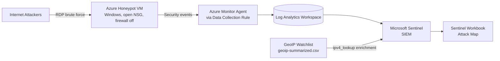
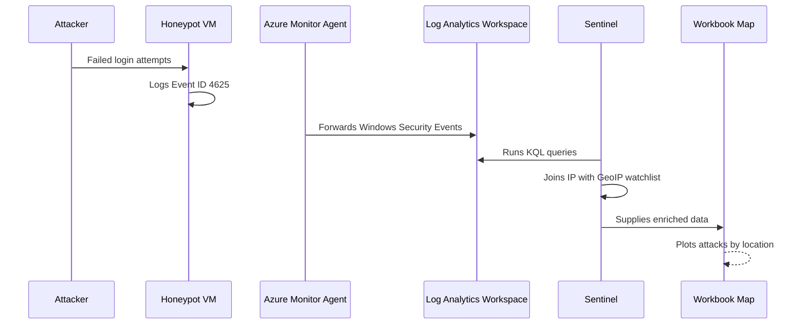

# Threat Radar Azure

**A cloud honeypot and SIEM lab that captures real-world attacks against an exposed Azure VM, enriches them with geolocation data, and visualizes them on a live attack map in Microsoft Sentinel.**

## Overview

This project deploys an intentionally exposed Windows virtual machine in Azure (a **honeypot**) and collects the failed login attempts that internet attackers make against it. Logs are forwarded to a **Log Analytics Workspace**, analyzed in **Microsoft Sentinel** using **KQL**, enriched with a GeoIP **watchlist**, and displayed on a **Sentinel Workbook attack map**.

It demonstrates core SOC analyst skills: log collection, event analysis, data enrichment, querying, and visualization.

## Objectives

- Deploy a honeypot VM in an isolated, disposable environment
- Identify failed logon events (Event ID 4625)
- Build a centralized log pipeline with Azure Monitor Agent
- Query security logs with KQL
- Enrich attacker IPs with geographic data
- Visualize attack sources on a world map

## Architecture

### Data Flow

## Tools and Technologies

| Category | Tool |
|---|---|
| Cloud platform | Microsoft Azure |
| Honeypot | Windows virtual machine |
| Network control | Network Security Group (NSG) |
| Log collection | Azure Monitor Agent, Data Collection Rule |
| Log storage | Log Analytics Workspace |
| SIEM | Microsoft Sentinel |
| Query language | Kusto Query Language (KQL) |
| Enrichment | Sentinel Watchlist (GeoIP CSV) |
| Visualization | Sentinel Workbook (JSON) |
