# Threat Radar Azure

**A cloud honeypot and SIEM lab that captures real-world attacks against an exposed Azure VM, enriches them with geolocation data, and visualizes them on an attack map in Microsoft Sentinel.**

## Table of Contents

- [Overview](#overview)
- [Objectives](#objectives)
- [Architecture](#architecture)
- [Tools and Technologies](#tools-and-technologies)
- [Lab Walkthrough](#lab-walkthrough)
- [KQL Queries](#kql-queries)
- [Results and Findings](#results-and-findings)
- [Challenges and Troubleshooting](#challenges-and-troubleshooting)
- [Lessons Learned](#lessons-learned)
- [Cost and Cleanup](#cost-and-cleanup)
- [Repository Structure](#repository-structure)
- [Disclaimer](#disclaimer)
- [Acknowledgments](#acknowledgments)

---

## Overview

This project deploys an intentionally exposed Windows virtual machine in Azure (a **honeypot**) and collects the failed login attempts that internet attackers make against it. Logs are forwarded to a **Log Analytics Workspace**, analyzed in **Microsoft Sentinel** using **KQL**, enriched with a GeoIP **watchlist**, and displayed on a **Sentinel Workbook attack map**.

It demonstrates core SOC analyst skills: log collection, event analysis, data enrichment, querying, and visualization.

## Objectives

- Deploy a honeypot VM in an isolated, disposable environment
- Identify failed logon events (Event ID 4625)
- Build a centralized log pipeline with Azure Monitor Agent and a Data Collection Rule
- Query security logs with KQL
- Enrich attacker IP addresses with geographic data
- Visualize attack sources on a world map

## Architecture

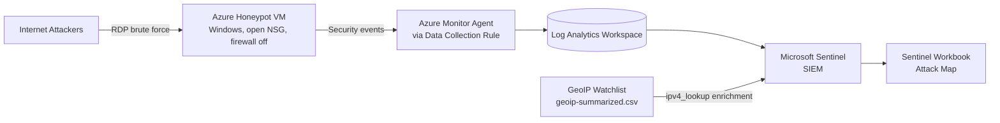

### Data Flow

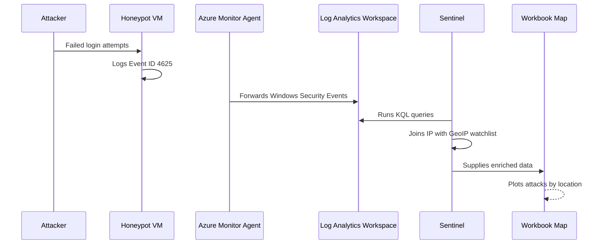

## Tools and Technologies

| Category | Tool |
|---|---|
| Cloud platform | Microsoft Azure (Azure for Students) |
| Honeypot | Windows virtual machine (Central India) |
| Network control | Network Security Group (NSG) |
| Log collection | Azure Monitor Agent, Data Collection Rule |
| Log storage | Log Analytics Workspace |
| SIEM | Microsoft Sentinel |
| Query language | Kusto Query Language (KQL) |
| Enrichment | Sentinel Watchlist (GeoIP CSV, about 55,000 rows) |
| Visualization | Sentinel Workbook (map) |
| Version control | Git, GitHub, VS Code |

## Lab Walkthrough

### 1. Create the honeypot VM

Created a Windows virtual machine in a new resource group, along with its public IP, network interface, disk, NSG and virtual network.

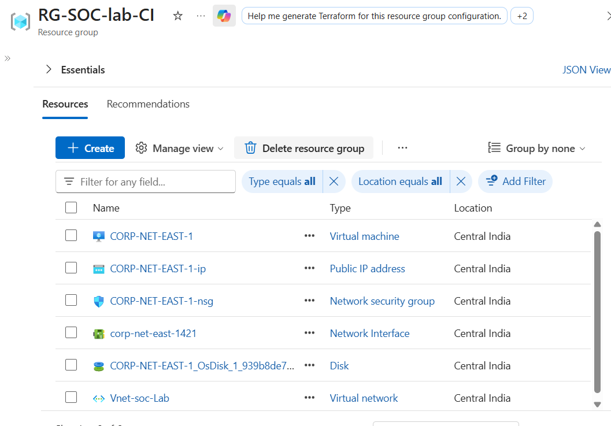

### 2. Open the network to the internet

Added an NSG inbound rule that allows all traffic, placed ahead of the default `DenyAllInBound` rule. Azure flags it as dangerous, which is expected for a honeypot.

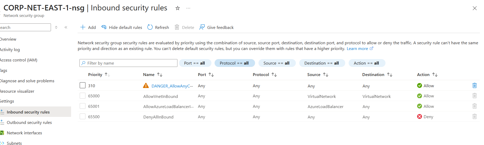

### 3. Turn off the Windows Firewall

Connected to the VM with Remote Desktop and turned the firewall off on the Domain, Private and Public profiles.

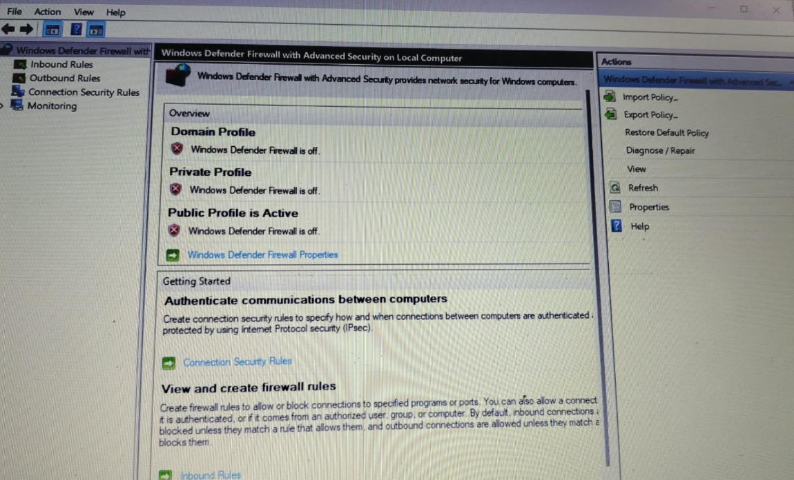

### 4. Inspect the failed logins

Opened Event Viewer and filtered the Security log for **Event ID 4625**. The VM had received tens of thousands of failed logons from automated scanners within about two days of being exposed.

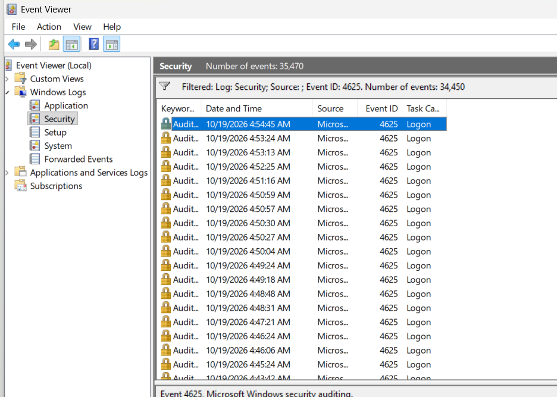

### 5. Send logs to Microsoft Sentinel

- Created a Log Analytics Workspace and added Microsoft Sentinel
- Installed the **Windows Security Events** solution and configured the **Windows Security Events via AMA** connector
- Created a Data Collection Rule (`DCR_Windows`, filter: all events) for the VM
- Confirmed the Azure Monitor Agent extension installed and the connector status changed to **Connected**

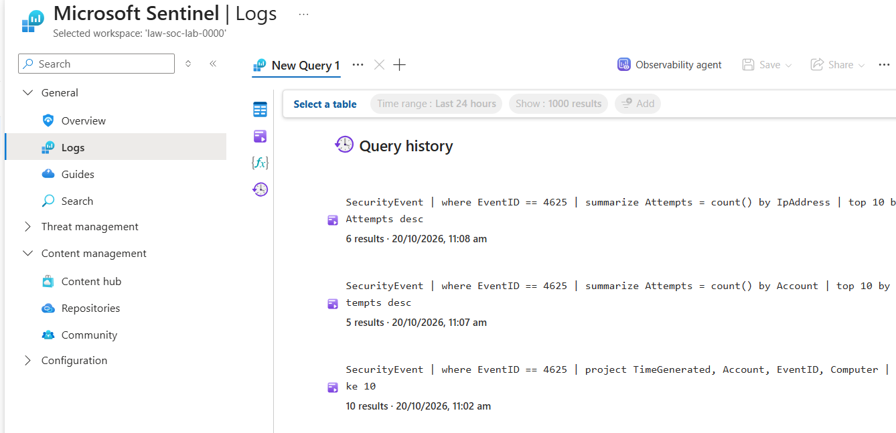

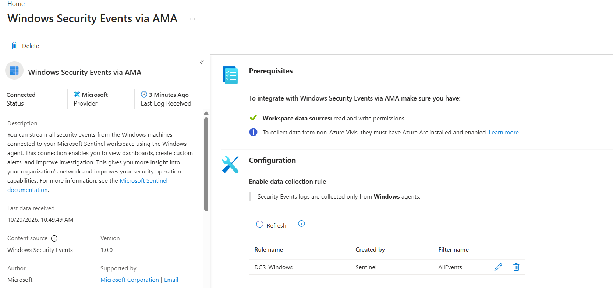

### 6. Query the logs with KQL

Ran queries for failed logons, most targeted usernames and top attacking sources.

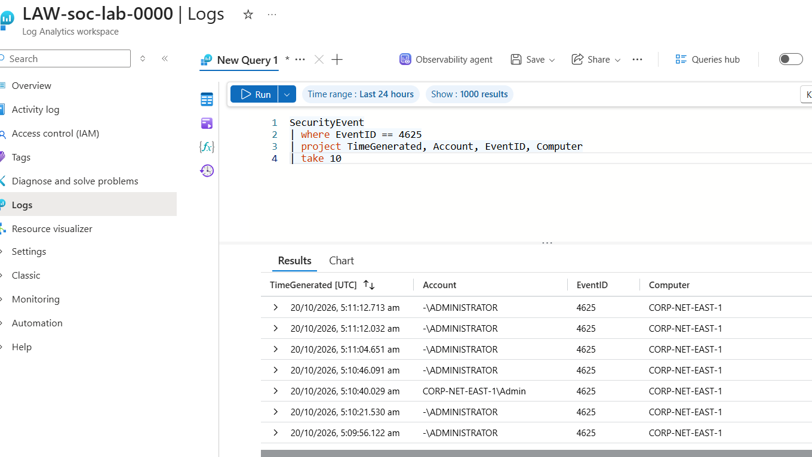

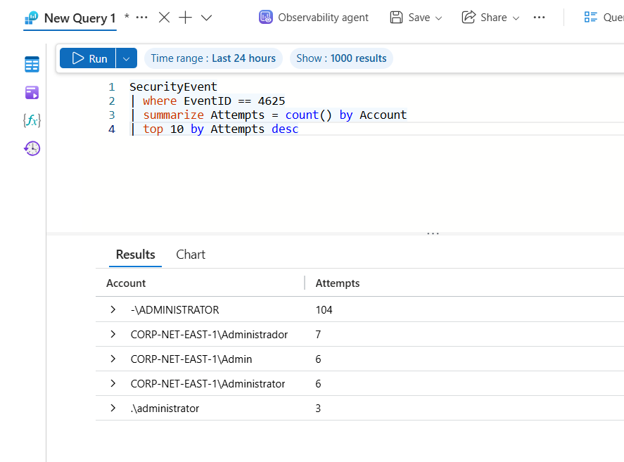

Attacker IP addresses are redacted in all screenshots.

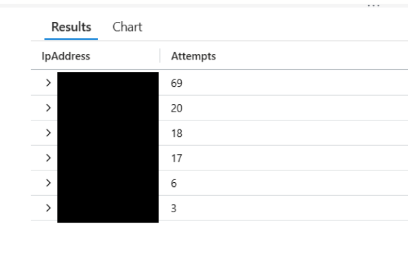

### 7. Enrich the logs with location data

Imported `geoip-summarized.csv` as a Sentinel watchlist (alias `geoip`, search key `network`, about 55,000 items) and used `ipv4_lookup` to add city, country, latitude and longitude to each failed logon.

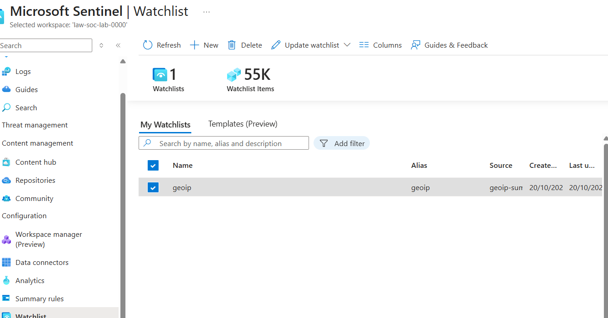

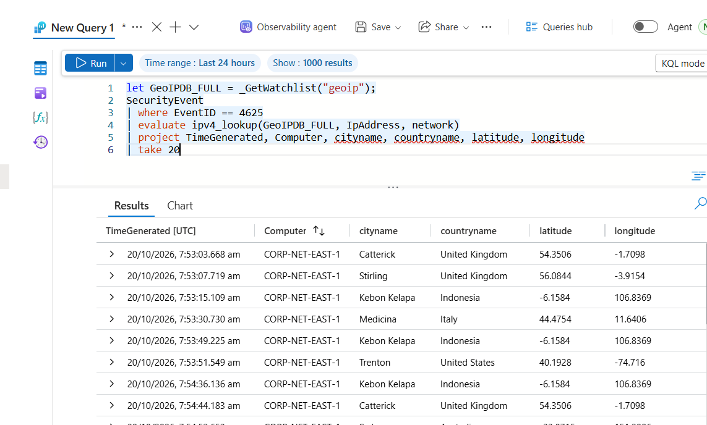

### 8. Build the attack map

Created a Sentinel Workbook with a map visualization. Bubble size and color show the number of failed logons per location.


## KQL Queries

All queries are in the [`queries/`](queries/) folder.

**Failed logons**
```kql
SecurityEvent
| where EventID == 4625
| order by TimeGenerated desc
```

**Top attacking IP addresses**
```kql
SecurityEvent
| where EventID == 4625
| summarize Attempts = count() by IpAddress
| top 10 by Attempts desc
```

**Most targeted usernames**
```kql
SecurityEvent
| where EventID == 4625
| summarize Attempts = count() by Account
| top 10 by Attempts desc
```

**GeoIP enrichment**
```kql
let GeoIPDB_FULL = _GetWatchlist("geoip");
SecurityEvent
| where EventID == 4625
| evaluate ipv4_lookup(GeoIPDB_FULL, IpAddress, network)
| project TimeGenerated, Computer, cityname, countryname, latitude, longitude
| take 20
```

**Attack map query**
```kql
let GeoIPDB_FULL = _GetWatchlist("geoip");
SecurityEvent
| where EventID == 4625
| evaluate ipv4_lookup(GeoIPDB_FULL, IpAddress, network)
| summarize FailureCount = count() by IpAddress, latitude, longitude, cityname, countryname
| project FailureCount, AttackerIp = IpAddress, latitude, longitude, city = cityname, country = countryname, friendly_location = strcat(cityname, " (", countryname, ")")
```

## Results and Findings

> The attack map snapshot below was taken early in the collection period. Update these numbers after the VM has run for 24 to 48 hours.

| Location (as reported by the GeoIP database) | Failed logons |
|---|---|
| Kebon Kelapa, Indonesia | 529 |
| Medicina, Italy | 143 |
| Catterick, United Kingdom | 129 |
| Stirling, United Kingdom | 124 |
| Trenton, United States | 106 |
| Sydney, Australia | 49 |
| Uljin County, South Korea | 10 |
| Los Angeles, United States | 4 |
| Kharkiv, Ukraine | 1 |

**Key observations**

- About 1,095 failed logons were mapped in this snapshot, and roughly 48% came from a single location in Indonesia
- Attacks started quickly. Within about two days of exposing the VM, its local Security log held over 34,000 failed logon events
- Attackers targeted common privileged account names such as `Administrator` and `Admin`, including a Spanish-language variant (`Administrador`)
- A small number of source IP addresses produced most of the attempts, which is typical of automated brute-force tools

**Caveats**

- GeoIP data is approximate. Attackers often use VPNs, proxies or compromised machines, so the location shows where an IP address is registered, not where the attacker is
- Sentinel counts only include events from after the connector was connected, so they are lower than the totals in the VM's local Event Viewer log

## Challenges and Troubleshooting

| Problem | Solution |
|---|---|
| Sentinel's Watchlist page showed that it had moved to the Defender portal | Used the Defender portal link, and later the Azure portal page loaded the watchlist normally. Microsoft is migrating Sentinel to the Defender portal, so menus differ from older tutorials |
| The workbook menu showed "Add data source" instead of "Add query" | Used **Add data source + visualization** and set the visualization to Map |
| The tutorial workbook JSON failed with an item type error | The step editor expects a specific item type. Built the map through the visual settings instead |
| Vim opened when committing a merge in Git | Saved with `:wq`, and set VS Code as the default Git editor |
| Failed login test showed `Administrator` instead of the test user | The log was dominated by real attackers. Filtered by username to find the test events |

## Lessons Learned

- Any internet-facing system with RDP open is found and attacked within hours
- Centralized logging with a SIEM makes large volumes of events searchable and comparable
- Raw logs lack context, and enrichment such as GeoIP makes them far more useful
- KQL is a core skill for security operations work
- Cloud portals change often, so understanding the concepts matters more than memorizing menus
- Cloud costs add up quickly, so budget alerts, daily caps and cleanup are part of the job

## Cost and Cleanup

To avoid charges, all resources should be removed after the project:

- [ ] Delete the resource group containing the VM, NSG, workspace and Sentinel
- [ ] Confirm no remaining billable resources in Cost Management

## Repository Structure

```
threat-radar-azure/
├── README.md
├── screenshots/
├── queries/
│   ├── failed-logins.kql
│   ├── top-attackers.kql
│   ├── top-usernames.kql
│   └── geo-enrichment.kql
└── workbook/
    └── map.json
```

## Disclaimer

This project was performed in a controlled, disposable environment for educational purposes. The honeypot was intentionally misconfigured and should never be replicated on production or personal systems. Subscription IDs, public IP addresses and attacker IP addresses have been removed from screenshots.


---
